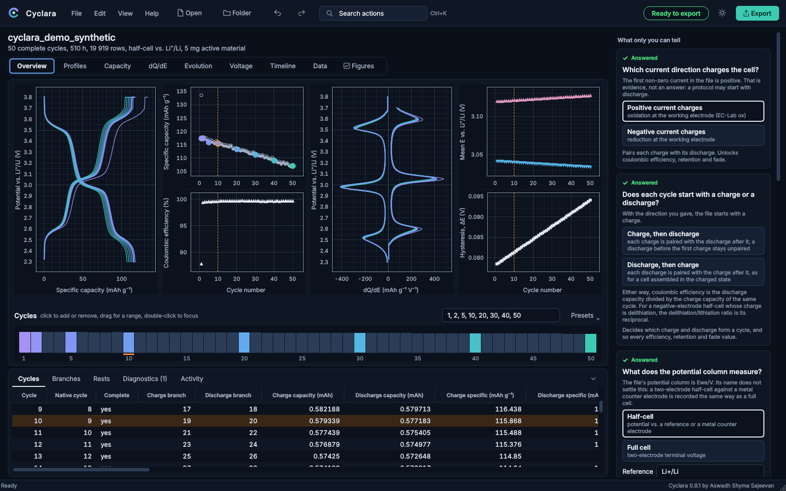
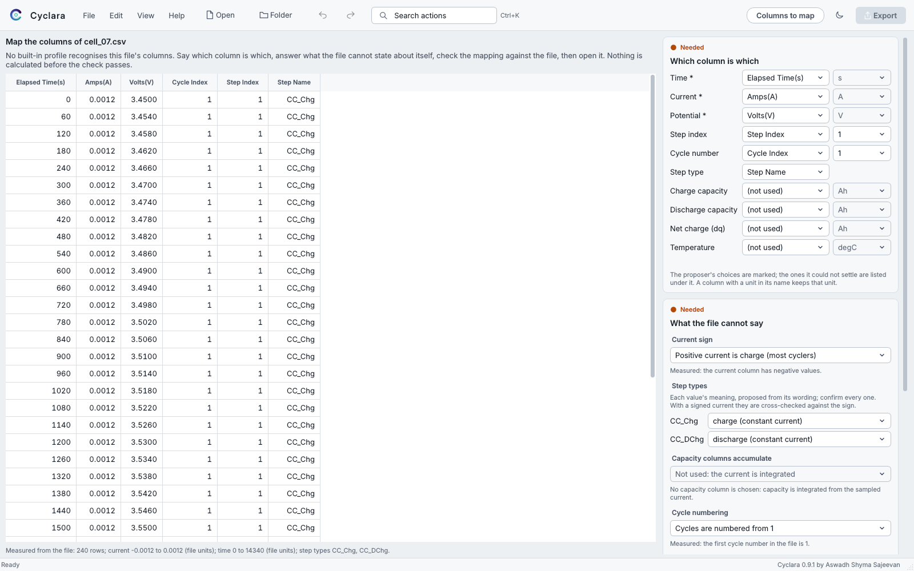
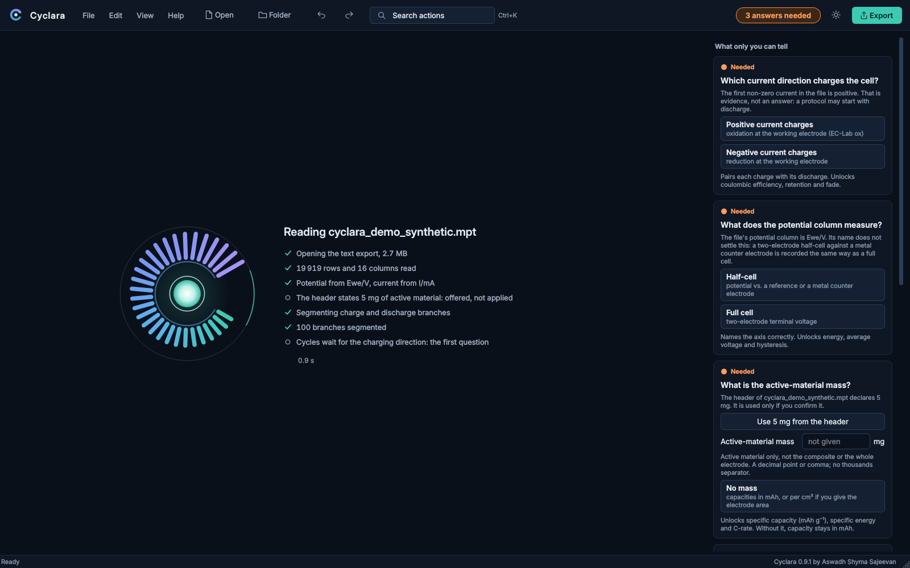
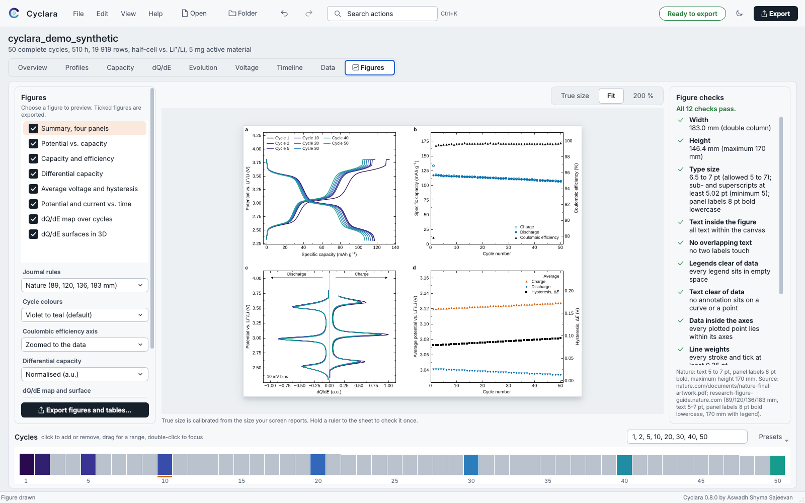
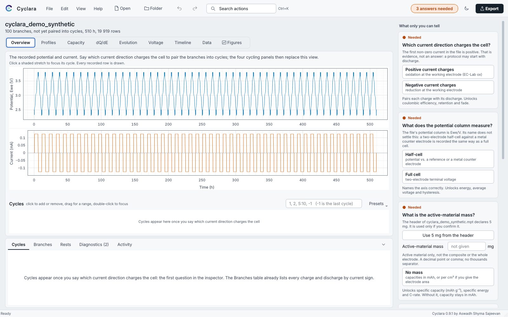
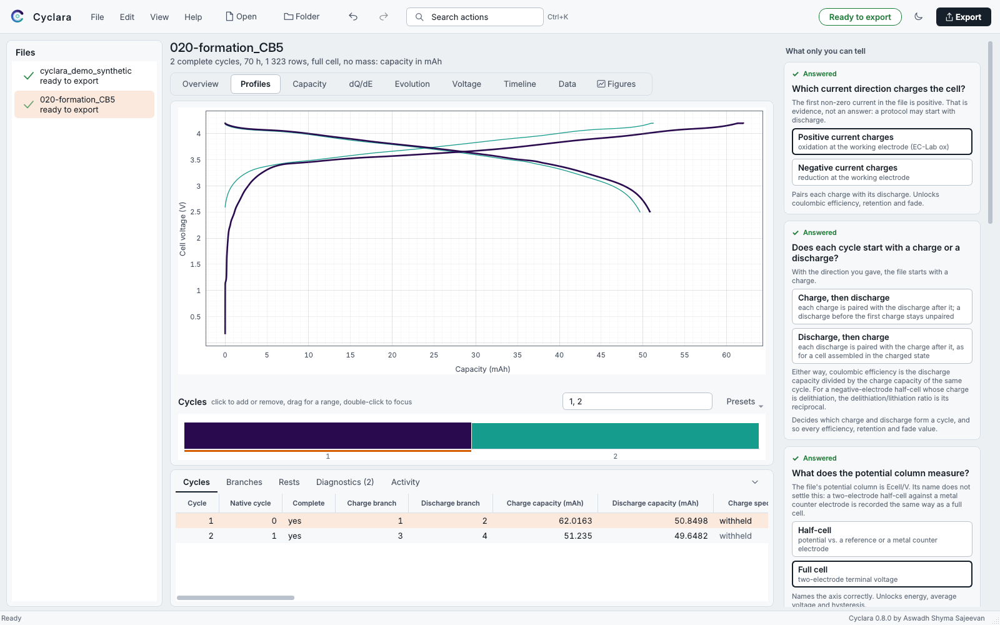
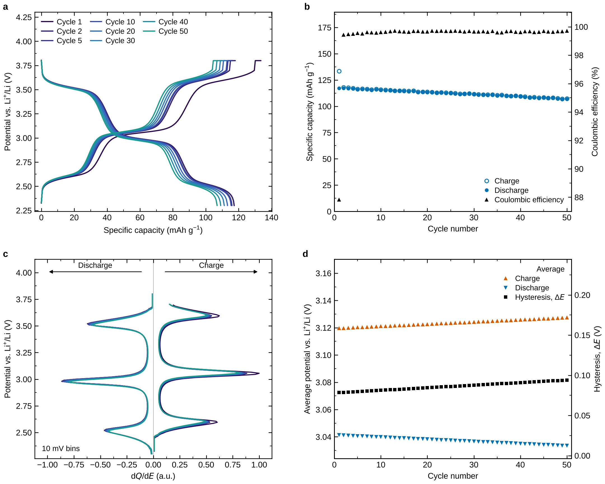

# Cyclara

**Every cycle, clearly.** A desktop app for battery cycling data: drop a file from BioLogic EC-Lab or the text or spreadsheet export of any other cycler, answer the three things only you know, and get every value, plot and journal-ready figure the data can justify, each traceable to its source rows. Built on **electrochem-toolkit**, the import and calculation engine in this repository, which also runs from one command.

Nothing is guessed. Missing current is never treated as zero, `Ewe` is never assumed to be cell voltage, charge is never integrated across an unexplained gap or reset, and the mass in the EC-Lab header is offered, never applied.

The toolkit is written for research on organic positive electrode materials and solid polymer electrolytes, where a Li-metal half-cell, a two-electrode full cell, a three-electrode cell and a blocking-electrode cell can all record the same column names with different meanings.

**Status (October 2026): cycling analysis, desktop app, command line, one-click installers.** Software-tested on Linux (offscreen) and reviewed independently; the Windows build is exercised under Wine (the real Windows binaries, the whole app, end to end); not yet run by users on a Windows PC or a Mac. Other cyclers: every text or spreadsheet export can be mapped and analysed; which instruments are recognised out of the box, and on what evidence, is in `docs/P08d_Instrument_Compatibility_Matrix.md`. CV and impedance analysis, and batch processing, are still to come. See [STATUS.md](STATUS.md).

New users: read **docs/Cyclara_handout.pdf** (illustrated) or `HOW_TO_USE.txt`.


<sub>Screenshots use `data/demo/cyclara_demo_synthetic.mpt`, a **synthetic** file made by `scripts/make_demo_data.py` (it says so in its header), so the pictures can show 50 cycles. One view of measured data is below.</sub>

## Install and open

Download the installer for your computer from the [latest release](https://github.com/asajeevan/electrochem-toolkit/releases/latest). Its files cannot be replaced after publication, and the page lists each file's SHA-256 and how to check it. A short tour, with a live figure and every download, is on [the Cyclara page](https://asajeevan.github.io/cyclara/).

**Windows** (10 version 1903 or later, or 11; 64-bit): run **Cyclara-0.8.0-Setup.exe**, click Next, Install, Finish. It installs into your user folder, with no administrator password, and puts Cyclara on the Desktop and in the Start menu. The first time, Windows SmartScreen may say "Windows protected your PC" because the installer carries no paid signing certificate: click *More info*, then *Run anyway*. Remove it from Settings > Apps.

**macOS** (14 Sonoma or later): unzip **Cyclara-0.8.0-macOS-AppleSilicon.zip** (M1 to M4) or **Cyclara-0.8.0-macOS-Intel.zip**, drag **Cyclara.app** to Applications and open it. The first time, macOS says it cannot verify the app (no paid Apple certificate): click Done, then System Settings > Privacy & Security > *Open Anyway*, and open it again. On an older macOS, right-click the app and choose Open.

Both carry their own Python 3.12 and every package; nothing else needs installing. For Origin projects (Windows, Origin 2021 or later): Help > *Set up the Origin link* once, then *Build Origin project* after any export, for files from any cycler. The installers are built from this repository by `installer/build.py` (see `installer/README.md` for what is verified and how).

**From the source folder** (any system with Python 3.12): double-click **Setup.bat** (Windows) or **Setup (Mac).command** once; each builds a `.venv`, runs the self-tests and creates the same shortcuts. Details under *Install by hand*.

## Using it

1. **Open** a file or a folder (`Ctrl+O`, or drop it anywhere on the window). The reading screen states what has actually been read: rows, columns, which potential and current columns are used, branches segmented. An EC-Lab file is recognised by its signature; any other cycler's text or Excel export is matched against the import profiles (`electrochem/readers/builtin.py` and the ones you save). A file no profile recognises opens a review page: the first rows, the proposed column roles and units, the three conventions no file states about itself (current sign, capacity semantics, cycle base) and a check that reads the whole file and compares the instrument's own capacity counter with the integral of the current. Confirm once and the instrument is remembered by its header. `docs/P08d_Instrument_Compatibility_Matrix.md` lists which instruments were verified on real files. *Try the demonstration* on the home page opens a synthetic 50-cycle cell.

   
   <sub>The import review page for a file from an invented instrument (the column names are made up for the picture).</sub>
2. **Answer** the questions on the right. Each shows what the file says (evidence, never a decision) and what the answer unlocks: which current direction charges the cell; whether each cycle starts with a charge or a discharge (asked when the file starts with a discharge); what the potential column measures; the active-material mass, or "No mass" for capacities in mAh.
3. **Review**. Pick cycles on the strip under the plots (click, drag, double-click, or type `1, 2, 5:10, -1`). Hover any curve for the measured point. A value that needs an answer you have not given is shown as *withheld*, with the reason.
4. **Export** from **Figures**: each figure at its journal size with its checks, every table, `settings.json` and an Origin folder, into a new folder. Nothing is ever overwritten.

| | |
|---|---|
|  |  |
| The reading screen lists only what has happened | Figures at true journal size, with their checks |
|  |  |
| Before any answer: the recorded potential and current | Measured data: the public formation file `020-formation_CB5.mpt`, full cell, no mass |

- **Undo** any answer (`Ctrl+Z`), in the file it was given for. **`Ctrl+K`** finds any action by name. Light and dark themes (the new one spreads from the switch as a widening circle); native menus on macOS; the bundled Inter typeface (SIL Open Font License).
- **Any screen** from 1024 × 600 points up, which is what a 14-inch laptop at 150 % scaling leaves: nothing is cut off. The Overview arranges its four panels for the room (2 × 2, a row of four, or the two main ones), axis titles shorten instead of being cut ("Specific capacity" becomes "Q"), and the tables under the plots fold to their tab row (`Ctrl+J`, or the chevron). The window opens at a size that fits the screen, maximised on a small one, and reopens where you left it.
- **Motion** (View > Motion): full, reduced (fades only) or off. The operating system's reduce-motion setting is followed until you choose.
- The cycle you **focus** (double-click, arrow keys, or a row of the Cycles table) is shown in every view; moving the focus never changes the selection, which is what the figures export.

## One command from file to figures

```sh
python -m electrochem.analyze data/public/mpt/020-formation_CB5.mpt --charge ox --terminal-voltage \
    --cycles 1,2 --out results/cb5
```


<sub>The four-panel summary, drawn from the synthetic demonstration file.</sub>

Run on a terminal, the command asks which figures you want (and for any convention you did not pass); `--plots 1,2,6` or `--plots all` answers in advance, `--no-prompt` never asks. `--list-plots` shows the choices. `--build-origin` also runs the Origin build at the end. `--cycle-order discharge-first` pairs each discharge with the charge after it.

**Figures** (each as vector PDF and SVG with editable text, plus 600 dpi PNG). Sizes and type follow the journal's own artwork pages (`--journal nature`, the default: 89, 120, 136 or 183 mm wide, text 5 to 7 pt, sub- and superscripts at least 5 pt, panel letters 8 pt bold lowercase; or `--journal elsevier`: 90, 140 or 190 mm, sub- and superscripts at least 6 pt). Each figure is saved at exactly that width and checked after drawing: width and height, type size including sub- and superscripts, text inside the canvas and not overlapping, legends clear of every kind of data (lines, points, bands, bars), annotations clear of data, every plotted point inside its axes, line and tick weights, colour contrast, typeface and editable text. Legends are placed where they cover nothing. The results are written to `settings.json`.

`fig1_potential_capacity`, `fig2_capacity_efficiency`, `fig3_dqde` (potential on the vertical axis, discharge left, charge right), `fig4_average_voltage`, `fig5_overview_time`, `fig6_dqde_map` and `fig7_dqde_surface` (every cycle's dQ/dE as a colour map and as 3D surfaces, cycle number as the second axis), and the four-panel `fig_summary`. `dqde_peaks.csv` gives every peak's capacity, its partner in the opposite branch (paired within 200 mV) or "unpaired", and the cycles in which it is seen; the inspector shows the focused cycle's plateaus in the same words.

**Tables**

| File | Contents |
|---|---|
| `summary.json` | first complete cycle's capacities and efficiency, maximum capacity and its cycle, retention at the last cycle, cycle at 80 % retention, capacity fade per cycle (linear fit), mean coulombic efficiency, mean average discharge potential and hysteresis, theoretical capacity and utilisation, total test time |
| `cycles.csv` | per cycle: charge and discharge capacity (mAh, mAh/g), coulombic efficiency and inefficiency, retention, degree of reaction Δx, average potentials and hysteresis, mid-capacity potentials, energies, specific energy, energy efficiency, C-rates, constant-voltage fraction, open-circuit potentials |
| `branches.csv` | per charge or discharge: capacity with its constant-current and constant-voltage parts, specific and areal capacity, utilisation, Δx, currents and current density, C-rate, potentials, energy, rests and relaxation, temperature, cross-check against the instrument counter, completeness and reasons |
| `rests.csv` | every rest: duration, potential at start and end, relaxation |
| `curves_potential_capacity.csv` | full-resolution curves of the plotted cycles |
| `dqde_curves.csv`, `dqde_peaks.csv` | differential capacity on the stated voltage grid, and peak positions, heights, prominences and widths |
| `origin/` | the same tables in Origin's three-line header layout, curves as X/Y column pairs, and `build_origin_project.py`, which on a PC with Origin 2021+ and `pip install originpro` builds the graphs and saves an editable `.opju` |
| `metadata.json` | everything the EC-Lab header declares, including the full programmed step table |
| `settings.json` | source hash, columns used, conventions, every processing choice, the equations, figure checks and warnings |

Two conventions are never guessed: `--charge ox|red` names the current sign that charges the cell, and either `--terminal-voltage` (two-electrode cell voltage) or `--reference "Li+/Li"` (half-cell) declares what the potential column means. In a three-electrode file, the half-cell answer analyses `Ewe/V` and the full-cell answer `Ecell/V`.

Validated against EC-Lab on a 110-cycle Li half-cell: coulombic efficiency matches EC-Lab's `Efficiency/%` to 4e-6 % and discharge capacity matches `Capacity/mA.h` to 6e-9 mAh, from either the MPR or the MPT. The synthetic demonstration file is also analysed in the test suite against its exact per-cycle charges.

## What works today

- Read EC-Lab and BT-Lab `.mpt` text exports with explicit encoding, decimal separator and column mapping, keeping the original tokens and line numbers; read native `.mpr` binaries through a pinned, optional [Galvani](https://github.com/echemdata/galvani) adapter.
- Recognise the text export of an `.mpr` by the file name its header gives, never by a shared prefix; read only its header block.
- Segment cycling data into charge and discharge branches from the programmed steps (`Ns`, `mode`), or, in a file without a step column, wherever the measured current changes sign; keep constant-current and constant-voltage stages of one direction together; report every time reset, duplicate timestamp, missing current or unexplained sign change as an interval that is never integrated.
- Pair branches charge-first or discharge-first; calculate capacity per branch, coulombic efficiency (never clipped above 100 %), retention against a chosen reference cycle, energy, mean voltage, hysteresis, energy efficiency, and specific or areal capacity, all on one basis with matching labels.
- Cross-check every branch against the instrument's own charge counter.
- Flag a branch that passed more than three times the median charge of its direction, and specific capacities above any electrode material's theoretical capacity (usually a wrong mass, such as EC-Lab's 0.001 mg default).
- Cyclara, the desktop app (PySide6 and pyqtgraph): the workflow above with linked views, the cycle strip, undo, figure preview with checks, and export.

## What does not work yet

- CV and impedance analysis, conductivity and VFT fits; batch processing and replicate statistics.
- Code signing: the installers are not signed, so Windows SmartScreen and macOS Gatekeeper ask once before the first launch (the handout shows the clicks). Not yet run by users on a physical Windows PC or a Mac, or with a screen reader. With the source-folder setup, the macOS menu bar names the app "Python"; the packaged `Cyclara.app` keeps its interpreter in `Contents/MacOS` so that macOS treats it as Cyclara, which has not yet been seen on a Mac.
- GITT/PITT, transference numbers, DRT (parked).

## Install by hand

Python 3.11 or 3.12.

```sh
git clone <this repository>
cd electrochem-toolkit
python -m venv .venv
.venv/bin/python -m pip install -r requirements.txt          # engine
.venv/bin/python -m pip install -r requirements-native.txt   # optional MPR reader, needs git
.venv/bin/python -m pip install -r requirements-gui.txt      # Cyclara
.venv/bin/python -m electrochem.studio                       # open Cyclara
```

On Windows replace `.venv/bin/python` with `.venv\Scripts\python.exe`.

## Run the tests

```sh
.venv/bin/python -m pip install pytest
.venv/bin/python -m pytest                # engine, figures, the app (offscreen) and the review fixes
.venv/bin/python reference/verify.py      # exact reference checks
```

## Layout

| Path | Contents |
|---|---|
| `electrochem/` | Cycling engine (`table.py`, `segment.py`, `cycling.py`, `differential.py`, `metadata.py`), figures and their checks (`plotting.py`), shared workflow (`workflow.py`), command (`analyze.py`) |
| `electrochem/studio/` | Cyclara: window, views, inspector, cycle strip, figure studio, motion, brand and platform support |
| `eclab_import/` | Text reader, native adapter, settings linkage |
| `tests/` | Engine, import, figure and app tests, and one test per finding of the independent review |
| `reference/` | Frozen synthetic cycling cases with exact expected values |
| `data/public/` | Public EC-Lab test files (CC BY 4.0 and other notices kept beside each file) |
| `data/demo/` | The synthetic demonstration file and its exact per-cycle charges |
| `docs/` | Method specification (M01), decision records, reviews, handout |

## Licence

GPL-3.0-or-later, see [LICENSE](LICENSE). The optional native reader Galvani is GPL-3.0-or-later and installed separately. PySide6 is used under the LGPL-3.0. Public test files keep their own notices.

## Author and citation

Created by **Aswadh Shyma Sajeevan** (PhD, Nantes Université, CNRS-IMN). If Cyclara or the toolkit contributes to a publication, please cite it: Help > *Cite Cyclara* in the app, `python -m electrochem.analyze --cite` (add `--bibtex`), or `CITATION.cff`; Help > *How the numbers are calculated* writes a methods paragraph from the settings of the open file. Or acknowledge "Cyclara / electrochem-toolkit by Aswadh Shyma Sajeevan, https://github.com/asajeevan/electrochem-toolkit". Every figure PDF and every `settings.json` carries this credit in its metadata.

## Troubleshooting

| Message | Meaning and fix |
|---|---|
| "... is impedance spectroscopy" / "no galvanostatic step" | Not a cycling file. This version analyses GCPL, CC and CCCV only. |
| "The .mpr reader is not installed" | Git was missing during setup. Install Git and run the setup again, or export .mpt from EC-Lab. |
| "An .mps file holds a protocol's settings" | Open the run's .mpr or .mpt instead. |
| "above the theoretical capacity of any insertion or alloying electrode" | Check the active-material mass; EC-Lab writes 0.001 mg when the field is left empty. |
| "Windows refused to write there" | A file from a previous export is open in Excel, Origin or a PDF viewer. Close it. |
| "originpro is not installed" | Origin is missing on this PC. Figures and tables are complete; only the .opju is skipped. |
| macOS says it cannot verify the app | Click Done, then System Settings > Privacy & Security > *Open Anyway*, and open Cyclara again (once). On macOS 14, right-click Cyclara.app and choose Open. |
